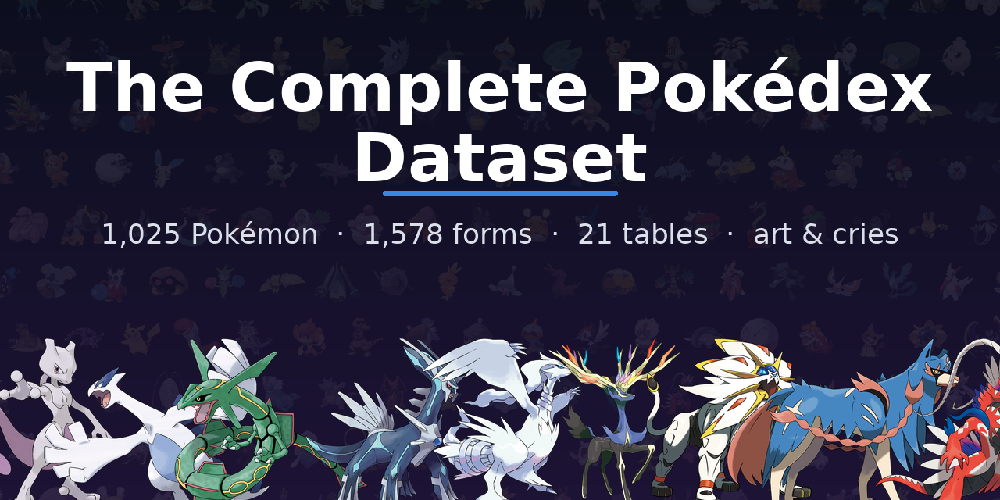

<center>
  
</center>

# The Complete Pokédex Dataset
Every **released Pokémon** (all **1,025 species** from Gen I Red/Green to Gen IX Scarlet/Violet and its DLC, #0001 Bulbasaur to #1025 Pecharunt) with every:
- **form**, **evolution** and **move**, plus full **learnsets**
- **ability**, **item**, **Pokédex entry** (11 languages) and **wild encounter**
- **month of Smogon usage statistics since 2014**, plus current competitive tiers

It also has **7,696 images** in seven art styles and **2,024 cries**, all linked by key and also packaged as one SQLite database. It is on Kaggle as [The Complete Pokédex Dataset](https://www.kaggle.com/cristobalmitchell/pokedex). The companion [Pokémon TCG dataset](https://github.com/cristobalmitchell/pokemon-tcg) links every English trading card to these species.

Species data is scraped from Serebii's Pokédex, with official descriptions from pokemon.com and artwork from Bulbapedia. The other tables are built from [PokéAPI](https://github.com/PokeAPI/pokeapi), [Pokémon Showdown](https://github.com/smogon/pokemon-showdown) and [Smogon's usage statistics](https://www.smogon.com/stats/). Every pipeline is in `scripts/` and can be re-run.

## Files

| File | Rows | One row per |
|---|---|---|
| **Pokémon** | | |
| [`data/pokemon_utf8.csv`](#pokemon_utf8csv--species) | 1,025 | species (72 columns). **Start here** |
| `data/pokemon.csv` | 1,025 | the same, in the original UTF-16, tab-separated format (`encoding='utf-16', sep='\t'`) |
| `data/pokemon_forms.csv` | 1,578 | form (Megas, Gigantamax, regional, alternate, cosmetic), each with its own stats, types, abilities and matchups |
| `data/evolutions.csv` | 702 | evolution method, with structured conditions and a readable sentence |
| `data/pokemon_stats.csv` | 6,150 | (species, base stat), long format |
| **Battle** | | |
| `data/moves.csv` | 920 | move |
| `data/pokemon_moves.csv` | 665,810 | learnset entry, every game from Red/Green to Legends: Z-A |
| `data/abilities.csv` | 314 | ability, with effect and in-game text |
| `data/pokemon_abilities.csv` | 2,943 | (variety, ability, slot) |
| `data/natures.csv` | 25 | nature |
| `data/type_chart.csv` | 324 | (attacking type, defending type) |
| `data/competitive_tiers.csv` | 1,380 | Pokémon Showdown entry: current singles, doubles and National Dex tiers |
| `data/smogon_usage.csv` | 520,661 | (month, format, Pokémon): Smogon usage at the standard and top-ladder cutoffs |
| **World** | | |
| `data/pokedex_entries.csv` | 98,396 | Pokédex entry, every game, 11 languages |
| `data/pokemon_names.csv` | 12,300 | (species, language): name and category |
| `data/encounters.csv` | 117,585 | wild encounter: game, location, method, levels, rate, conditions |
| `data/items.csv` | 2,221 | item |
| `data/machines.csv` | 2,508 | (game, TM/HM/TR): the move it teaches |
| `data/pokedex_numbers.csv` | 8,010 | (species, regional Pokédex): number |
| `data/version_groups.csv` | 32 | game group (lookup) |
| **Images and audio** | | |
| `data/images.csv` | 7,696 | image: the form shown, its types, size and a fixed train/val/test split |
| `data/cries.csv` | 2,024 | cry: form, format, duration and split |
| `data/pokedex.sqlite` | | every table above, with keys *(built by `scripts/build_sqlite.py`; published on Kaggle, not stored in git)* |

[`dataset-metadata.json`](dataset-metadata.json) documents every column of every file. It is the data dictionary Kaggle shows, and `scripts/validate.py` checks that it matches the files.

### How the tables join
```
pokemon (national_number) ─┬─< pokemon_forms (form_id, pokemon_id) ─┬─< pokemon_moves (pokemon_id) >── moves (move_id) ─< machines
                           │                                        ├─< pokemon_abilities (pokemon_id) >── abilities (ability_id)
                           │                                        ├─< images / cries (form_id)
                           │                                        └─< competitive_tiers (form_id)
                           ├─< evolutions (from_ / to_national_number)
                           ├─< pokedex_entries, pokemon_names, pokedex_numbers, encounters, pokemon_stats
                           └─< smogon_usage (national_number, pokemon_id)
```
- `national_number` identifies a species.
- `pokemon_id` identifies a *variety*: forms with their own battle data, such as Alolan Raichu or Mega Charizard X. Learnsets, abilities and encounters are keyed on it.
- `form_id` identifies a single form, including cosmetic ones such as Unown B or a Vivillon pattern.

## Images and audio
| Folder | Files | What | In git |
|---|---|---|---|
| `images/small_images` | 1,025 | official artwork of every primary form, 215 × 215 | yes |
| `images/large_images` | 1,025 | high-resolution artwork, 300–1280 px | yes |
| `images/alt_images` | 360 | variant forms: regional, Mega (incl. Legends: Z-A), Gigantamax, ... | yes |
| `images/shiny_images` | 1,340 | shiny official artwork | Kaggle only |
| `images/home_images` | 1,335 | Pokémon HOME 3D renders, 512 × 512 | Kaggle only |
| `images/home_shiny_images` | 1,328 | Pokémon HOME 3D renders, shiny | Kaggle only |
| `images/animated_sprites` | 1,283 | animated battle sprites (GIF) | Kaggle only |
| `audio/cries` | 1,351 | current cries (Ogg Vorbis; 116 MP3) | yes |
| `audio/cries_legacy` | 673 | original Gen I–V cries | yes |
| `images/type_icons` | 18 | type icons | yes |

The four Kaggle-only image sets add about 630 MB. `scripts/build_media.py` builds them, and `.gitignore` keeps them out of git.

In `images.csv` and `cries.csv`, every file is linked to the exact form it shows, with that form's types as ready-made labels. The 70 / 15 / 15 train / val / test split is assigned **by species** and stratified by primary type, so every image and cry of a species stays in the same split.

## Build
`bash scripts/build_all.sh` rebuilds everything from the sources (cloned into `.cache/`). It runs:

| Script | Builds |
|---|---|
| `build_tables.py` | species fixes and enrichment, forms, evolutions, moves, learnsets, abilities, items, natures, type chart, Pokédex entries, names, encounters, regional dex numbers, machines (from the [PokéAPI CSV database](https://github.com/PokeAPI/pokeapi/tree/master/data/v2/csv)) |
| `build_competitive.py` | `competitive_tiers.csv` (Pokémon Showdown) and `smogon_usage.csv` (downloads Smogon's monthly files once, then caches them; `--min-usage 0` keeps the full long tail, about 2.5 million rows) |
| `build_media.py` | the image sets, cries, `images.csv` and `cries.csv` (from [PokéAPI sprites](https://github.com/PokeAPI/sprites) and [cries](https://github.com/PokeAPI/cries)) |
| `build_sqlite.py` | `data/pokedex.sqlite` |
| `build_metadata.py` | `dataset-metadata.json` from the column docs and `docs/kaggle_description.md` |
| `validate.py` | the integrity checks; run before every upload |

`SKIP_MEDIA=1 bash scripts/build_all.sh` rebuilds the tables without the 1 GB sprite download. `pokedex.ipynb` is the original scraper for the species table and the bundled artwork. `notebooks/pokedex_eda.ipynb` is a starter analysis ready to fork on Kaggle.

### What `validate.py` checks
- **Keys:** keys and foreign keys in every table.
- **Values:** stat ranges, base stat totals, EV yields and gender ratios.
- **Type matchups:** every `against_*` value and the type chart, recomputed independently.
- **Consistency across tables:** species, forms, abilities, names, images, cries and splits agree.
- **Text quality:** no form notes or garbled text in ability cells, and every species has a current cry and an English Pokédex entry.
- **Competitive data:** Smogon ranges and duplicates, and at least 99% of competitive rows mapped to a species.
- **Files:** Kaggle-safe file names.
- **Database and metadata:** the SQLite row counts and foreign keys, and metadata that matches every column.

## Dataset

### `pokemon_utf8.csv`: species
All 1,025 Pokémon from Gen I to Gen IX, one row each.
* **national_number:** The entry number of the Pokémon in the National Pokédex
* **gen:** The generation in which the Pokémon was first introduced (I–IX; #899–#905 from Legends: Arceus count as Gen VIII)
* **english_name:** The English name of the Pokémon
* **japanese_name / japanese_name_kana / japanese_name_official:** The Japanese name, romanized phonetically (Iorofu), in katakana (イオルブ), and in the official trademark spelling (Eolb)
* **primary_type / secondary_type:** Types of the primary form
* **classification:** Category from the current English Pokédex (e.g. "Seed Pokémon")
* **color / shape / habitat:** Pokédex color and body shape. The habitat comes from the FireRed/LeafGreen Pokédex, so only Gen I–III species have one
* **percent_male / percent_female:** Exact gender ratios (blank if genderless)
* **height_m / weight_kg:** Height and weight
* **capture_rate:** Capture rate (3–255)
* **base_egg_steps:** Steps to hatch (hatch cycles × 256)
* **base_experience / base_friendship / growth_rate / egg_group_1 / egg_group_2:** Experience, friendship (Gen VIII+ values) and breeding data
* **hp / attack / defense / sp_attack / sp_defense / speed / base_total:** Base stats
* **ev_yield_*:** EVs gained for defeating the Pokémon
* **abilities_0 / abilities_1 / abilities_hidden:** Current abilities of the primary form. `abilities_2` is always blank, because no species has a third regular ability; it is kept for older notebooks
* **against_*:** Damage multiplier taken from each attacking type (pure type chart; abilities not applied)
* **is_sublegendary / is_legendary / is_mythical:** Legendary status
* **evochain_*:** The evolution chain. The odd columns say how the next species is obtained; `evolutions.csv` has the full branching tree
* **gigantamax / mega_evolution / mega_evolution_alt:** Gigantamax and Mega forms (including Legends: Z-A and Mega Dimension)
* **description:** Pokédex description from pokemon.com

### Other tables in brief
- **`pokemon_forms.csv`:** every form with its own types, stats, abilities, size, EV yield, matchups and artwork.
  - `form_category` is one of default, mega, primal, gigantamax, regional, totem, battle-only, alternate or cosmetic.
  - `is_default_form == 1` gives one row per variety (1,351 rows). Adding `is_default_variety == 1` gives one row per species.
- **`evolutions.csv`:** each method has structured columns (`min_level`, `item`, `held_item`, `known_move`, `time_of_day`, `location`, ...) and a readable `condition`, e.g. *"Level up with high friendship (160+) during the day"*.
- **`moves.csv` / `pokemon_moves.csv`:** moves have type, category, power, accuracy, PP, priority, effects and mechanics. Learnsets give who learns what, how and at what level, for every game.
- **`competitive_tiers.csv`:** the Smogon tiers Pokémon Showdown currently uses: singles (Uber, OU, UU, RU, NU, PU, ZU, LC), doubles and National Dex. `is_nonstandard` marks Pokémon not available in Gen IX.
- **`smogon_usage.csv`:**
  - **Coverage:** monthly usage since November 2014 for 170 standard formats across every generation (OU to ZU, Ubers, LC, Monotype, Doubles, National Dex, Anything Goes, 1v1, VGC, Battle Stadium and Battle Spot). Before July 2017, Smogon's unprefixed formats were Gen VI, so they are stored as `gen6...`.
  - **What each row holds:** weighted usage at Smogon's standard 1500 cutoff (`usage_pct`) and at the format's top-ladder cutoff (`usage_pct_top`), with the number of teams that used it and the number of times it was sent into battle.
  - **The 1% filter:** a Pokémon is kept for a month if at least 1% of teams used it at either cutoff. That drops the long tail of near-zero entries, which would be about 2.5 million rows.
- **`pokedex_entries.csv`:** every Pokédex entry from every game in English, Japanese (kana and kanji), Korean, Chinese (traditional and simplified), French, German, Spanish (Spain and Latin America) and Italian.
- **`encounters.csv`:** where each Pokémon appears in the wild in each game, with method, levels, encounter rate and conditions (time of day, season, swarms, Max Raids, ...).

## Credits and licenses
* **Species data:** [Serebii.net](https://www.serebii.net)
* **Pokédex descriptions:** [pokemon.com](https://www.pokemon.com)
* **Bundled artwork:** [Bulbapedia](https://bulbapedia.bulbagarden.net)
* **[PokéAPI](https://github.com/PokeAPI/pokeapi) database:** the source of the forms, evolutions, moves, learnsets, abilities, items, natures, type chart, Pokédex entries, names, encounters, regional dex numbers, machines and the added species fields. Copyright © 2013–2023 Paul Hallett and PokéAPI contributors, used under the BSD-3-Clause license; see [`LICENSE-PokeAPI.md`](LICENSE-PokeAPI.md).
* **Shiny, HOME and animated sprites, and cries:** the [PokéAPI sprites](https://github.com/PokeAPI/sprites) and [cries](https://github.com/PokeAPI/cries) repositories (CC0 as compilations; the contents are © The Pokémon Company).
* **Competitive tiers:** [Pokémon Showdown](https://github.com/smogon/pokemon-showdown) (MIT). **Usage statistics:** [Smogon](https://www.smogon.com/stats/).
* **Trademarks:** Pokémon and Pokémon character names are trademarks of Nintendo. Artwork, sprites and cries are © Nintendo, Creatures Inc. and GAME FREAK and are included for non-commercial research and education.

## Changelog

### 2026-11: v3, competitive, media and reference release
* **Fixes to the species table:**
  * **Abilities corrected on 34 species.** Other forms' abilities had leaked into the base species (Raichu's "Surge Surfer (Alola Form)", the Galarian birds, the Therian formes, Kyurem, Zygarde, Calyrex). There was garbled text ("Snow Cloak- Slush Rush" for Sandshrew, "Snow Cloak- Snow Warning" for Vulpix), missed Gen IX changes (Piplup's line now has Competitive, Shiftry Wind Rider, Gallade Sharpness) and old spellings ("Compoundeyes").
  * **Classification corrected on 19 species** to the current English category (e.g. Weedle "Hairy Bug Pokémon"; typos such as "Tiny Racoon" and "Wickid" fixed).
  * Added `japanese_name_kana` and `japanese_name_official`.
* **New reference tables:**
  * `abilities.csv` and `pokemon_abilities.csv`
  * `items.csv`, `natures.csv` and `type_chart.csv`
  * `pokedex_entries.csv` (98,396 entries, 11 languages) and `pokemon_names.csv`
  * `encounters.csv` (117,585 rows), `pokedex_numbers.csv`, `machines.csv` and `version_groups.csv`
* **Competitive data:** `competitive_tiers.csv` (Pokémon Showdown) and `smogon_usage.csv` (520,661 rows, November 2014 to October 2026).
* **Media:**
  * new image sets: shiny artwork, HOME renders (normal and shiny) and animated sprites, 5,286 images in all
  * 2,024 cries; 116 upstream files named `.ogg` are really MP3 and now have the right extension
  * `cries.csv`; `images.csv` now covers all seven image sets
* **Database:** `pokedex.sqlite` now holds all 23 tables. Because it is about 117 MB, it is rebuilt by `scripts/build_sqlite.py` and published on Kaggle rather than kept in git.
* **Pipeline:** added `scripts/build_all.sh`, `build_competitive.py`, `build_media.py`, `build_sqlite.py` and `build_metadata.py`. `validate.py` now covers every table.
* **Cleanup:** removed stray macOS `.DS_Store` files from the image folders.
* **Not filled in:** nine Mega Dimension Megas (Mega Heatran, Darkrai, Zygarde, Magearna, Zeraora and the three Tatsugiri) still have no abilities. Their official abilities could not be confirmed.

### 2026-11: v2, relational release
* **New tables:**
  * `pokemon_forms.csv` (1,578 forms with their own stats, types, abilities and matchups)
  * `evolutions.csv` (702 methods with structured conditions)
  * `moves.csv` (920) and `pokemon_moves.csv` (665,810 learnset rows covering every game)
  * `images.csv` (the image manifest with a fixed split) and `pokedex.sqlite`
* **New species columns:** `color`, `shape`, `habitat`, `base_experience`, `base_friendship`, `growth_rate`, `egg_group_1`, `egg_group_2`, `base_total` and six `ev_yield_*`.
* **Evolution chains:** rewrote the `evochain_*` method text from structured data. 752 cells previously said only "Level" and now give the level or condition. Stray whitespace is gone, the Mime Jr. and Mr. Mime spellings are fixed, and the leftover Galarian fragments on the Slowpoke and Slowbro rows are removed.
* **Corrections:**
  * Cresselia's Defense and Special Defense (120/130 → 110/120), and Zacian's and Zamazenta's Attack (130 → 120), as changed in Scarlet/Violet
  * Melmetal and Zarude are now flagged Mythical
  * Minior's `capture_rate` is now the integer 30
* **Artwork:** `large_images/888.png` and `889.png` showed the Crowned forms and now show the Hero forms, matching `small_images` and the stats. The Crowned artwork moved to `alt_images`.

### 2026: Gen IX update
* Added the 127 missing Pokémon: #899–#905 (Legends: Arceus) and #906–#1025 (Scarlet/Violet, The Teal Mask, The Indigo Disk), collected from Serebii/pokemondb and cross-verified field by field
* Renamed the misspelled column `against_psychict` → `against_psychic`
* Fixed 27 rows where a regional variant's type had leaked into `primary_type`/`secondary_type`. Types now always describe the primary form
* Normalized `percent_male`/`percent_female` to the exact in-game gender ratios
* Added the missing `Gigantamax Appletun` form and the Mega Evolutions from Legends: Z-A and its Mega Dimension DLC (87 species now have Mega forms)
* Updated `evochain_*` for species that gained new evolutions in Legends: Arceus and Scarlet/Violet
* Rewrote `pokedex.ipynb` for pandas 2.x with the Scarlet/Violet Pokédex as the primary source; the `against_*` columns are now computed exactly from the type chart
* Completed all imagesets through #1025, and backfilled the alternate forms the pre-Gen VIII curation had missed (Hisuian and Paldean forms, Origin Dialga and Palkia, Eternamax Eternatus, Pumpkaboo and Gourgeist sizes, Furfrou trims, etc.)
